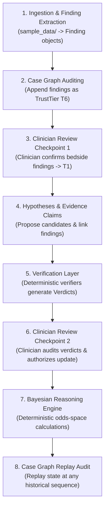

# Medagents Prototype — Demonstration Instructions

**Date:** 2026-11-17  
**Workspace:** `C:\Users\DELL\Desktop\prototype of madd`  
**Stages Demonstrated:** Stages 1 through 5 (Full Pipeline)  
**Status:** READY FOR LIVE DEMONSTRATION — 99 / 99 Tests Passing  

---

## 1. Important Safety & Demonstration Notice

> [!IMPORTANT]
> **RESEARCH & PROTOTYPE DEMONSTRATION NOTICE:**
> - All patient encounter records, clinical terminology codes, laboratory values, epidemiological priors, and likelihood ratios used in this demonstration are **synthetic illustrative benchmark values**.
> - The output probability bands (`HIGH`, `MODERATE`, `LOW`, `VERY_LOW`) are **unvalidated demonstration bands** for interface and algorithm verification only.
> - They are **NOT** clinical risk classifications and **MUST NEVER** be used for clinical triage, diagnosis, or patient management.

---

## 2. Prerequisites

- Operating System: Windows 10/11
- Shell: PowerShell 5.1+ or PowerShell 7+
- Python: Python 3.10+ (Current environment: Python 3.14.7)
- Working Directory: `C:\Users\DELL\Desktop\prototype of madd`

Verify prerequisites:
```powershell
cd "C:\Users\DELL\Desktop\prototype of madd"
python --version
```

---

## 3. Running the Complete Automated Test Suite

Before running the live demo, execute the full test suite covering all 5 stages:

```powershell
python -m pytest tests -v --tb=short
```

Expected output:
```text
======================== 99 passed, 1 warning in ~2.5s ========================
```

---

## 4. Running the Live Prototype Demonstration

Run the complete end-to-end demonstration script from PowerShell:

```powershell
python .\scripts\run_demo.py
```

### Optional Command-Line Arguments:
You can specify a different synthetic encounter from `sample_data/` or a custom data directory:

```powershell
# Demonstrate a different encounter (e.g., ENC000011)
python .\scripts\run_demo.py --encounter ENC000011

# View help and available options
python .\scripts\run_demo.py --help
```

---

## 5. Walkthrough of the Demonstration Workflow

The demonstration script executes the complete 8-step pipeline:



### Step 1: Ingestion & Extraction (Stages 1 & 2)
Loads the adult encounter `ENC000015` from `sample_data/` and extracts symptoms, vitals, labs, and history into validated Pydantic models conforming to `finding.schema.json`.

### Step 2: Case Graph Initial State (Stage 3)
Appends the 18 extracted findings to an append-only event store (`EventStore`). All findings are strictly stored with trust tier `T6` (unreviewed machine extraction) and confirmation status `pending`.

### Step 3: Clinician Checkpoint 1 (Review & Confirmation)
Simulates clinician interaction where Dr. A. Rao reviews the patient bedside findings (Fever, Myalgia, and Headache). The demonstration explicitly enforces that synthetic findings remain T6 and cannot influence Bayesian scoring, even after simulated clinician confirmation.

### Step 4: Hypothesis & Claim Generation
Proposes candidate hypotheses (`Dengue fever`, `Malaria`, `Bacterial sepsis`, and a rare condition with no KB prior). Generates structured evidence `Claim` objects linking confirmed findings to candidate diseases.

### Step 5: Verification Layer (Stage 4)
Dispatches claims through deterministic verifiers (`KBLinkChecker`, `MNMChecker`, etc.) with in-memory caching and disagreement arbitration, appending auditable `Verdict` objects to the graph.

### Step 6: Clinician Checkpoint 2 (Verification Audit)
Presents the verified evidence links and rule validations to the clinician for oversight and scoring authorization.

### Step 7: Deterministic Bayesian Reasoning Engine (Stage 5)
Calculates posterior probabilities strictly in odds space using Bayes' theorem:
- $\text{odds}_0 = \frac{p_0}{1 - p_0}$
- $\text{odds}_n = \text{odds}_0 \times \prod LR_i$
- $p_{\text{raw}} = \frac{\text{odds}_n}{1 + \text{odds}_n}$
- Demonstrates the synthetic evidence safety gate: No likelihood ratios applied. Effective LR Product: 1.00. Posterior scores remain unchanged from their baseline priors.
- Displays complete mathematical trace and flags Must-Not-Miss conditions.

### Step 8: Historical Replay & Audit Integrity
Executes `replay(target_version=K)` to prove that the append-only event log deterministically reconstructs exact historical states at any past point in the encounter.
